# Custom CSS examples

Ready-made styles for `chat.html`. Each file is a full working example with comments explaining what every line does and why, so you can also use them to learn how to write your own.

## How to use one

1. Open the file and copy everything in it.
2. In OBS, open the browser source's **Properties** and replace everything in the **Custom CSS** box with it.
3. Click **OK**.

This works the same with the [hosted version](../README.md#1-hosted-version) and with [your own copy](../README.md#2-your-own-copy) of `chat.html`, which itself stays unchanged. To go back to the normal look, delete what you pasted.

To try them first, open the [URL builder](https://slendog.github.io/SimpleTwitchChat/), enter a channel and pick a theme under **Look**. The live preview shows it on real chat, and **Copy CSS** copies it for OBS.

You can combine several examples by pasting them one after another, e.g. `01-bigger-text.css` with `03-message-boxes.css`. If two examples change the same thing, the one pasted last wins. If one of them uses `@import` (like `02-different-font.css`), that line has to go at the very top of the box.

## The examples

They're numbered from simplest to most advanced. If you're new to CSS, start at the top: each one adds only a couple of new ideas. Click a file name to open it.

The [`images/`](images/) folder has the sample badge images used by example 11.

The screenshots show the same made-up chat in each style: the "Connected" line, a few messages, a `/me` message, a sub notice and a name with a 7TV paint.

### Basic: a few lines each

#### [`01-bigger-text.css`](01-bigger-text.css): Bigger text

Bigger text, emotes and GIFs.

**You learn:** CSS variables, and why some of them need `!important`.

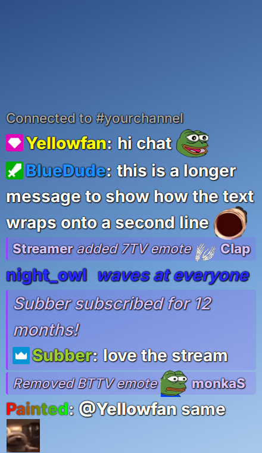

#### [`02-different-font.css`](02-different-font.css): Different font

Loads a font from Google Fonts (Nunito) and uses it for the whole chat.

**You learn:** `@import`, font fallback lists.

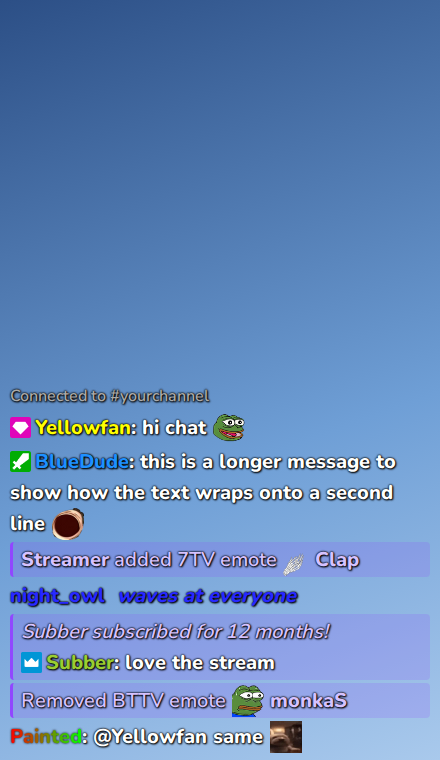

#### [`03-message-boxes.css`](03-message-boxes.css): Message boxes

A dark rounded box behind each message, as wide as its text.

**You learn:** `background`, `padding`, `border-radius`, transparency.

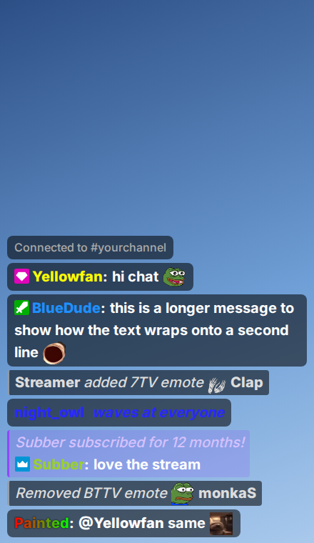

#### [`04-name-on-own-line.css`](04-name-on-own-line.css): Name on its own line

The name on one line, the message indented below it.

**You learn:** How a message is built from parts, `display: block` vs inline.

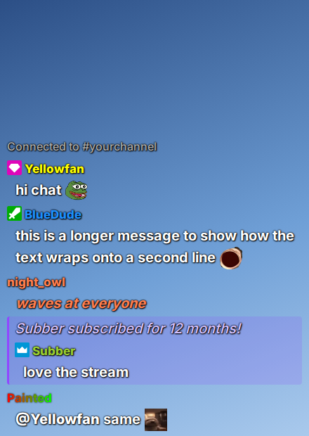

#### [`05-newest-on-top.css`](05-newest-on-top.css): Newest on top

Chat pinned to the top with the newest message first, aligned right.

**You learn:** Moving the chat column, `flex-direction`, `text-align`.

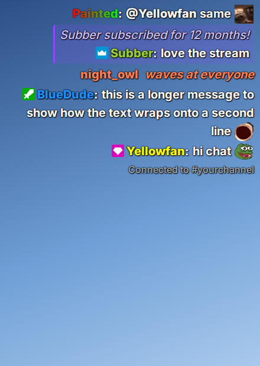

#### [`06-hide-things.css`](06-hide-things.css): Hiding things

A list of things you can hide: badges, the loading bar, notices, the status line, GIFs, `/me` messages, one user, 7TV paints. Pick the lines you want. The screenshot uses all of them.

**You learn:** `display: none`, choosing elements with selectors.

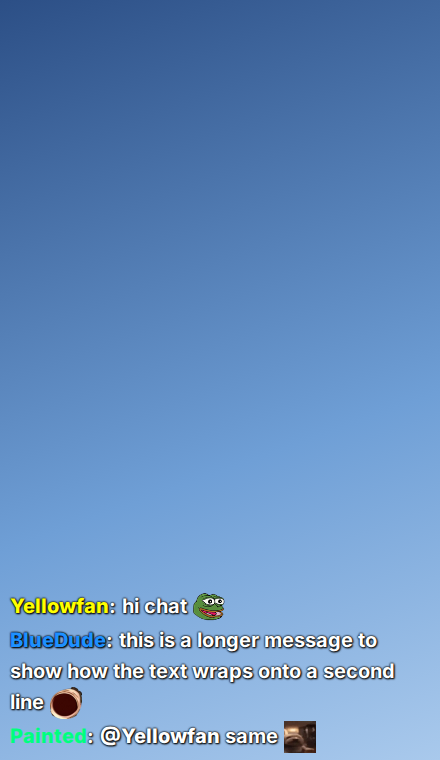

### Medium: a complete look

#### [`07-dark-panel.css`](07-dark-panel.css): Dark panel

A solid dark chat panel instead of text floating over the game, with every other row slightly lighter.

**You learn:** Page background, `:nth-child()`, `font-weight`.

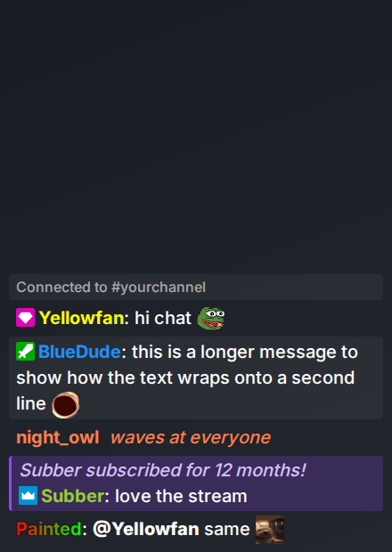

#### [`08-speech-bubbles.css`](08-speech-bubbles.css): Speech bubbles

White comic-style bubbles with a little tail.

**You learn:** `::after`, the CSS triangle trick, `position: relative/absolute`.

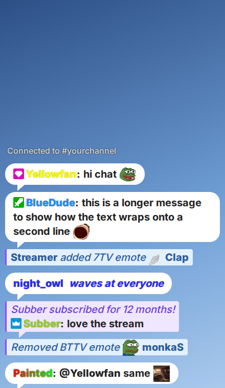

#### [`09-neon.css`](09-neon.css): Neon

Names glow in their own color, text has a soft blue glow.

**You learn:** Stacked `text-shadow`, `currentColor`, `filter: drop-shadow`.

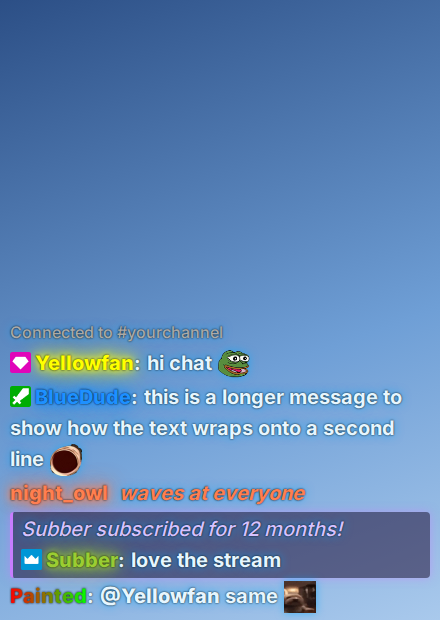

#### [`10-terminal.css`](10-terminal.css): Terminal

Green monospace "hacker terminal" with a `>` prompt. Names are all one green, except 7TV paints, which stay (with `paints=0`, every name is green).

**You learn:** `::before` with text, overriding name colors, cross-platform font lists.

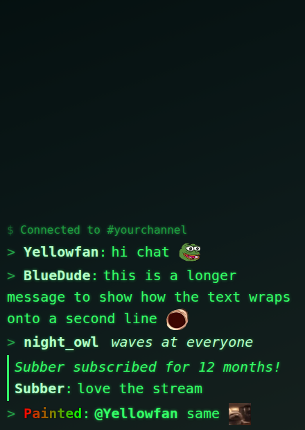

#### [`11-custom-badges.css`](11-custom-badges.css): Custom badges and images

Your own images for the moderator, VIP and broadcaster badges, hides the Prime and Turbo badges, and gives one specific person an extra badge (the star). Lists the names of all common Twitch badges so you can swap any of them. The sample images are in [`images/`](images/).

The second half explains where images can come from: a web address (works everywhere), a file on your own computer (only with your own copy of `chat.html`; which path to write for each OBS setup), or a `data:` URL that puts the image inside the CSS itself, with commands to make one on Windows, macOS and Linux.

**You learn:** attribute selectors (`[alt^="moderator/"]`), `content: url()` to swap an image, `background-image` on `::after`, relative and absolute file paths, `data:` URLs, why websites can't read your files.

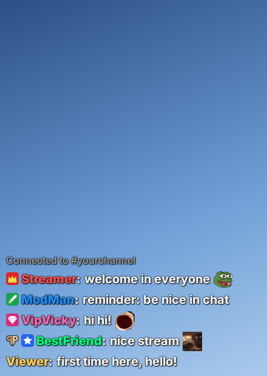

### Advanced

#### [`12-clouds.css`](12-clouds.css): Clouds

The name sits above, and the message goes in a fluffy white cloud with a soft shadow. Sub notices get a lilac cloud.

The file has a second layout, with the name in a small pill on the cloud's top edge (right screenshot). To switch to it, change `@media not all` to `@media all` in section 7.

**You learn:** CSS masks built from gradients, `::before`/`::after` as background shapes, stacking contexts (`isolation`), grid, `content-box`.

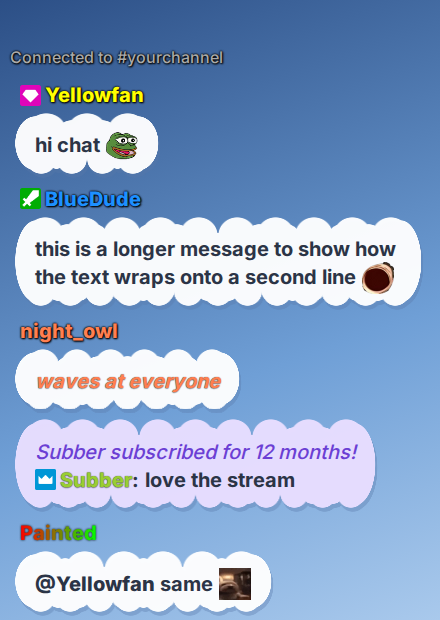 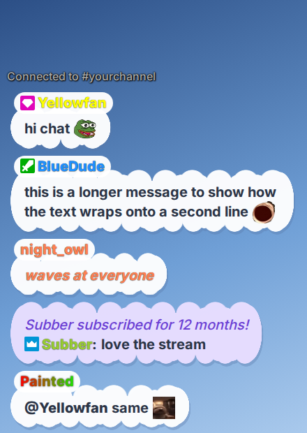

## Writing your own

[REFERENCE.md](../REFERENCE.md#custom-css-reference) lists every class you can style (`.msg`, `.name`, `.body`, `.emote`, …) and the variables (`--size`, `--emote`, …).

The quickest way to experiment: open `chat.html?channel=yourchannel` in Chrome or Edge, press **F12**, and edit styles live in the **Elements** tab. When it looks right, copy your CSS into OBS.

Three rules that catch most people out:

- **`--size`, `--emote`, `--gif` and `--font` need `!important`.** The overlay sets them from the URL options, which beat normal CSS.
- **Name colors and 7TV paints need `!important` too.** The overlay puts them directly on each name.
- **`@import` must be the first thing in the Custom CSS box.** Anything before it makes the browser ignore it.
